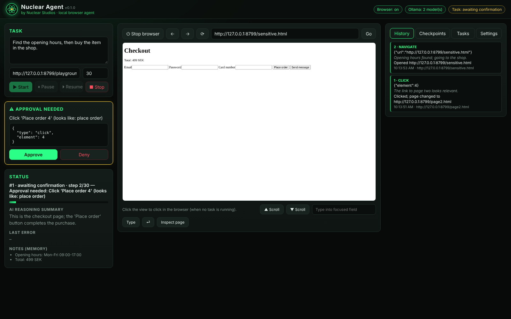

# ☢ Nuclear Agent

**A local, autonomous browser agent by Nuclear Studios.**

Nuclear Agent runs on your own Windows PC. You describe a task in plain language
("open a website, find the opening hours and summarize them") and it controls a real
Chromium browser **one action at a time**: look, decide, act, check, repeat. The
AI runs locally through [Ollama](https://ollama.com). No paid APIs, no cloud
browser, and no five-minute session limit.



---

## Features

- **Real browser:** Playwright + Chromium, visible or headless, with a persistent profile so your logins stay between runs.
- **Browser tools:** navigate, click, type, select, keys, scroll, back/forward, screenshots, page text and numbered interactive elements.
- **Step-by-step autonomy:** observe → decide one action → safety check → execute → verify. It never fires off long blind action sequences.
- **Pause / Resume / Stop** at any time. Pausing discards any planned action, so nothing stale runs after you have changed the page.
- **Persistent tasks:** all tasks, actions and checkpoints are saved in SQLite. If the app or PC shuts down, resume the task from its last checkpoint.
- **Crash recovery:** if Chromium dies, the agent restarts it on the page it was on, up to a limit you set.
- **Safety gate:**
  - purchases, messages, posts, account changes and personal-data entry wait for your **Approve / Deny**
  - passwords, card numbers and one-time codes are **never** filled in by the agent
  - CAPTCHAs and bot checks are **never** solved by the agent; it hands control back to you
- **Honest about vision:** it detects which Ollama models really accept images. Text-only models are told they cannot see, and use the DOM (plus optional OCR) instead.
- **Low VRAM use:** small context window, one model at a time, configurable `keep_alive`.
- **Control panel:** a dark web UI with live screenshots, status, a short AI reasoning summary, action history, checkpoint/memory viewer, task list, model picker and settings. Refreshing the panel never affects a running task.
- **Use it from other AIs (like TinyFish, but on your own PC):** an MCP server with tools such as `run_web_task`, `wait_for_task` and `get_screenshot`.
  - Claude Desktop: one click with `connect_claude.bat`.
  - Cursor and other apps on the PC: `http://127.0.0.1:8765/mcp`.
  - ChatGPT and other apps outside the PC: through a Cloudflare tunnel with `remote.bat`.
- **HTML panel on GitHub Pages:** `docs/index.html` is a full remote control you can open like a normal website, including on your phone.
- **Secure by default:**
  - the server listens on localhost only, and every remote call needs an API key with scopes
  - an AI key can never approve purchases or messages (only you can)
  - tunnel access is off until you switch it on
  - CORS allow-list, rate limits and an audit log
  - see [docs/REMOTE_ACCESS.md](docs/REMOTE_ACCESS.md)

---

## Requirements

| | |
|---|---|
| OS | Windows 10 or 11 (64-bit) |
| Python | 3.10 – 3.13 ([python.org](https://www.python.org/downloads/windows/)). Tick **"Add python.exe to PATH"** during setup. |
| Ollama | [ollama.com/download](https://ollama.com/download) |
| GPU | Optional but recommended. Tuned for ~8 GB VRAM (e.g. RTX 3050 8 GB). |
| Disk | ~1 GB for the app + Chromium, plus your models (qwen2.5:7b ≈ 4.7 GB) |

## Installation (step by step)

1. **Install Python** (see table above). Tick *Add python.exe to PATH*.
2. **Install Ollama** from <https://ollama.com/download> and start it. It runs in the system tray.
3. **Download Nuclear Agent:** on GitHub, press **Code → Download ZIP** and unzip it, or run
   `git clone https://github.com/<your-account>/nuclear-agent.git`.
4. **Double-click `install.bat`.** It:
   - creates a private Python environment in `.venv`
   - installs the Python packages from `requirements.txt`
   - downloads Playwright's Chromium
   - creates `config.json` from `config.example.json`
   - offers to download the recommended model `qwen2.5:7b` (you can say No)
5. **Double-click `start.bat`.** The control panel opens at <http://127.0.0.1:8765/>.

### Choosing models for an 8 GB GPU

| Model | Download | Use |
|---|---|---|
| `qwen2.5:7b` | ~4.7 GB | **Recommended planner.** Good at following the JSON action format. |
| `qwen2.5:3b` | ~1.9 GB | Faster and lighter, but makes more mistakes. |
| `qwen2.5vl:3b` | ~3.2 GB | Vision model: can read screenshots. Use as planner, or as the "separate vision model". |
| `qwen2.5vl:7b` | ~6.0 GB | Better vision, but tight on 8 GB, especially next to another model. |

```
ollama pull qwen2.5:7b
ollama pull qwen2.5vl:3b     (optional, for screenshots)
```

Tips for limited VRAM:
- Vision is **off by default**. The DOM element list plus page text is usually enough and uses far less memory.
- Using a separate vision model means two models take turns in VRAM, which is slower. Using `qwen2.5vl:3b` as the only model is a lighter alternative.
- Lower **Context size** (Settings) to 4096 if you run out of memory.
- **Keep model loaded** (`keep_alive`) controls how long the model stays in VRAM after each step. Set it to `0` to free VRAM immediately (slower steps).

## Using it

1. Open **Settings**, press **↻ Refresh models**, pick your planner model and press **Save settings**.
2. Type a task, e.g. *"Go to sv.wikipedia.org, find how many people live in Örnsköldsvik and summarize it."*
3. Optional: add a **Start URL**, and change the max actions (default 30).
4. Press **▶ Start**. Watch the live view, the reasoning summary and the history.
5. If the agent needs you, a yellow card appears:
   - **Approval needed:** press Approve or Deny.
   - **Your turn:** log in, solve a CAPTCHA or answer a question (in the browser window or with the reply box), then press **Resume**.
6. The final answer appears under **Result**. Old tasks are in the **Tasks** tab. Stopped, failed or interrupted tasks can be resumed from their last checkpoint there.

**Manual control:** when no task is running (or it's paused), click the live view to
click in the browser, use the scroll/type/⏎ buttons, or type a URL.
**Inspect page** shows exactly what the AI sees.

### Logging in to sites

Use the visible browser window (headless off, the default) and log in yourself.
With *Keep logins between runs* on, the session is stored in `data/profile`.
The agent will never type passwords for you.

## Use it from other AIs (MCP) and from the web

The full guide is in **[docs/REMOTE_ACCESS.md](docs/REMOTE_ACCESS.md)**. In short:

| Who | How |
|---|---|
| Claude Desktop on this PC | Double-click `connect_claude.bat`, then restart Claude Desktop. |
| Claude Code | `claude mcp add nuclear-agent -- "<repo>\.venv\Scripts\python.exe" "<repo>\nuclear_mcp.py"` |
| Cursor and other apps on this PC | MCP URL `http://127.0.0.1:8765/mcp` with header `Authorization: Bearer <AI key>` |
| ChatGPT, your phone, other PCs | In Settings: *Allow remote access* plus a key. Run `remote.bat` and use `https://<tunnel>/mcp/k/<key>`. |
| Browser / phone panel | Publish `docs/` with GitHub Pages and log in with a **Panel** key. |

MCP tools:

| Tool | What it does |
|---|---|
| `run_web_task(task, start_url?, wait_seconds?)` | Starts a task and returns the result, or a `task_id` if it isn't done yet |
| `wait_for_task(task_id, seconds)` | Waits for a running task |
| `get_task(task_id)` | Status and result of a task |
| `reply_to_agent(text)` | Answers a question the agent asked |
| `stop_task()` | Stops the current task |
| `list_tasks(limit)` | Lists recent tasks |
| `get_screenshot()` | Returns what the agent's browser shows now |

Approvals for sensitive actions always come from a person, in the local panel or the GitHub Pages panel with a Panel key.

### Publish the HTML panel (GitHub Pages)
1. In the GitHub repo, go to **Settings → Pages → Deploy from a branch**, choose branch `main` and folder `/docs`, and press **Save**.
2. After about a minute it is live at `https://<your-name>.github.io/<repo>/`.
3. In Nuclear Agent, go to **Settings → AI connections** and create a key of type **Panel (you)**. Log in with it on the page.
4. Check that `https://<your-name>.github.io` is listed under *Web pages allowed to connect*.

## Snabbguide på svenska

1. Kör `install.bat` och sedan `start.bat`. Panelen öppnas på http://127.0.0.1:8765.
2. **Claude på din dator:** kör `connect_claude.bat` och starta om Claude Desktop. Be Claude: *"Använd Nuclear Agent för att …"*.
3. **Webbsidan (GitHub Pages):** aktivera Pages för mappen `/docs`. Skapa en **Panel**-nyckel i *Settings → AI connections* och logga in med den på sidan.
4. **ChatGPT eller mobilen utanför hemmet:**
   1. Bocka i *Allow remote access* och spara.
   2. Installera cloudflared med `winget install --id Cloudflare.cloudflared` och kör `remote.bat`.
   3. Använd adressen som visas, till exempel `https://xxx.trycloudflare.com/mcp/k/<nyckel>`.
5. En AI kan aldrig godkänna köp eller meddelanden. Det gör alltid du.

## Configuration

All settings are in `config.json`, created from `config.example.json`. Most
can be changed in the Settings tab. Notable ones:

| Setting | Default | Meaning |
|---|---|---|
| `agent.max_actions` | 30 | Action limit per task. When reached, the task pauses and you can allow more. |
| `agent.step_timeout_s` | 240 | Max time for one model decision |
| `agent.max_consecutive_errors` | 3 | Errors in a row before the agent stops and asks you |
| `agent.max_browser_restarts` | 2 | Automatic browser restarts per task after a crash |
| `agent.confirm_sensitive_actions` | true | Ask before purchases/messages/etc. (keep it on) |
| `ollama.num_ctx` | 8192 | Model context window (lower = less VRAM) |
| `browser.headless` | false | Hide the browser window |
| `browser.executable_path` | "" | Use an installed Chrome/Edge instead of Playwright's Chromium |
| `server.port` | 8765 | Control panel port (host is always 127.0.0.1) |
| `remote.enabled` | false | Allow access through a tunnel (a key is still required) |
| `remote.allowed_origins` | your github.io | Web pages allowed to call the agent from a browser |

## Optional: OCR

For pages whose text is drawn in images or on a canvas, the agent can use
Tesseract OCR as a fallback when the page has almost no readable text.
1. Install Tesseract for Windows: <https://github.com/UB-Mannheim/tesseract/wiki>,
   in the default folder `C:\Program Files\Tesseract-OCR`.
2. Restart Nuclear Agent. Settings will show *OCR fallback (available)*.

## Running the tests

```
run_tests.bat
```
or `.venv\Scripts\python.exe -m pytest -v tests`. The tests start a hidden
Chromium against local test pages in `tests/pages` (no internet needed). A
scripted fake model stands in for Ollama, so the tests run without a GPU.

## Troubleshooting

| Problem | Fix |
|---|---|
| `Python was not found` | Install Python from python.org with *Add to PATH*. Close and reopen the terminal. Disable the Microsoft Store alias in *Settings → Apps → Advanced app settings → App execution aliases* if needed. |
| `Executable doesn't exist ... chromium` | Run `.venv\Scripts\python.exe -m playwright install chromium` |
| Panel says **Ollama: offline** | Start Ollama from the Start menu (tray icon), then press ↻ Refresh models. Check <http://127.0.0.1:11434> in a browser. |
| `Model 'x' is not installed` | `ollama pull qwen2.5:7b`, then pick it in Settings |
| Steps are very slow / timeout | Use a smaller model, lower Context size, turn vision off, raise *Step timeout* |
| Out of VRAM / Ollama errors | Use one model only, `num_ctx` 4096, `keep_alive` 0, close games and other GPU apps |
| Agent repeats the same action | Pause, help it in the browser (or with a reply), Resume. Or rephrase the task more concretely. |
| `Could not start server on port 8765` | Nuclear Agent is already running, or the port is taken: `start.bat --port 8766` |
| *Missing or invalid token* | The server was restarted. Reload the control panel page. |
| Browser window doesn't appear | Untick *Headless* in Settings, Save, then stop and start the browser |
| A site blocks the agent / shows CAPTCHA | Expected. Nuclear Agent does not bypass bot protection. Solve it yourself and press Resume, or use another site. |
| Claude Desktop doesn't show Nuclear Agent | Run `connect_claude.bat` again, then fully quit Claude Desktop from the tray and reopen it. The log is in `data/logs/started_by_mcp.log`. |
| GitHub Pages panel: "Kunde inte nå agenten" | Make sure the agent is running and the page's address is in *Web pages allowed to connect*. On the same PC use `http://127.0.0.1:8765` and allow "local network access" if Chrome asks. On other devices use the `remote.bat` address. |
| `Remote access is turned off` | Tick *Allow remote access* in Settings and press Save. |
| AI says it can't approve | By design. Approve in the panel. |
| Something else | Logs are in `data/logs/agent.log`. Remote calls are logged in `data/logs/remote_audit.jsonl`. |

## Project structure

```
nuclear-agent/
├─ install.bat / start.bat / run_tests.bat
├─ connect_claude.bat / remote.bat / nuclear_mcp.py   AI connections
├─ requirements.txt, config.example.json
├─ nuclear_agent/
│  ├─ __main__.py   entry point (localhost-only check, logging)
│  ├─ server.py     FastAPI API + panel (token, Host/Origin checks)
│  ├─ engine.py     background thread + event loop for browser and agent
│  ├─ browser.py    Playwright control, element indexing, crash detection
│  ├─ dom.py        in-page JavaScript (elements, text, CAPTCHA detection)
│  ├─ agent.py      task loop, pause/resume/stop, approvals, recovery
│  ├─ safety.py     sensitive-action rules (EN + SV)
│  ├─ llm.py        Ollama client, model + vision detection
│  ├─ prompts.py    compact prompt for small local models
│  ├─ storage.py    SQLite: tasks, actions, checkpoints
│  ├─ ocr.py        optional Tesseract fallback
│  ├─ keys.py       API keys (hashed), scopes, rate limits
│  ├─ service.py    what remote clients may do (scope checks, audit log)
│  ├─ remote.py     /remote/v1 REST API + /mcp endpoint, tunnel rules
│  ├─ mcp_tools.py  the MCP tools (shared by HTTP and stdio)
│  ├─ mcp_stdio.py  stdio MCP server for Claude Desktop/Code
│  ├─ setup_claude.py  adds the agent to Claude Desktop's config
│  └─ config.py     settings with validation
├─ web/             control panel (HTML/CSS/JS, no build step)
├─ tests/           pytest suite + local test pages
└─ docs/            index.html = GitHub Pages panel, REMOTE_ACCESS.md
```

## Privacy and what never goes to GitHub

`.gitignore` excludes `data/` (browser profile, cookies, task database,
screenshots, logs), `config.json`, `.env` files and keys. Check `git status`
before every push. If you ever see `data/` or `config.json` listed, stop.

## Remote access

Nuclear Agent only listens on `127.0.0.1`. Uploading this repository to GitHub
does **not** let ChatGPT or anyone else control your PC. Outside access needs:
- *Allow remote access* switched on
- `remote.bat` running a tunnel
- a valid API key

See [docs/REMOTE_ACCESS.md](docs/REMOTE_ACCESS.md).

## Known limitations

- Small local models make mistakes. Expect to help them now and then, and keep tasks concrete.
- One task at a time (one browser).
- Content inside cross-origin iframes is not listed as elements.
- Downloads are disabled for the agent.
- Prompt-injection defence is best effort: page text is marked as untrusted and the safety gate blocks risky actions, but no local model is immune.

---
Made by **Nuclear Studios**.
